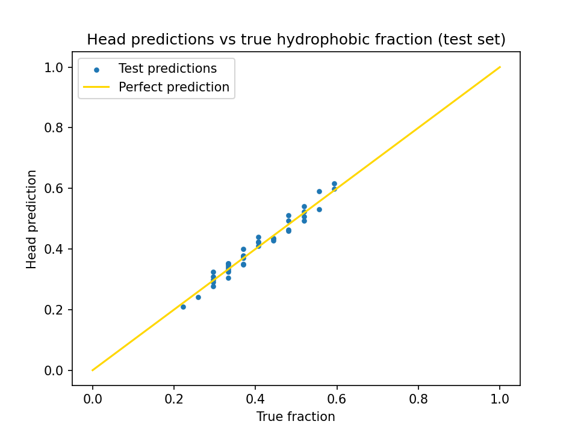
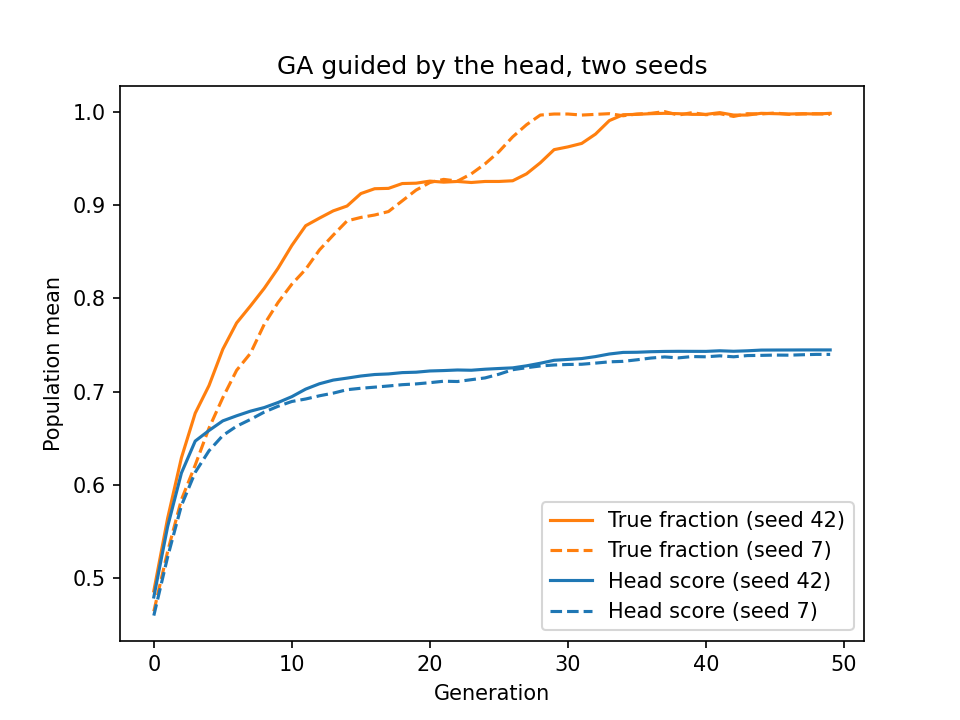

# esm2-guided-ga

A small experiment: can a genetic algorithm (GA) be guided by a *learned* model instead of an exact fitness function?

Here a GA evolves protein-like sequences of 27 amino acids. In one version the fitness is computed exactly. In the other, the fitness is *predicted* by a small neural network trained on top of [ESM-2](https://huggingface.co/facebook/esm2_t6_8M_UR50D) embeddings, and the GA never sees the true value.

## Purpose

Sometimes the property you want to optimise cannot be computed directly. It may require an experiment or a very expensive simulation, so you can only afford a fast model that *predicts* it. The question is whether a GA guided only by such a prediction still improves the property you actually care about.

To test this, I use a property that can be computed exactly, so that both the prediction and the ground truth are available for comparison: the **fraction of hydrophobic residues** in a sequence (A, I, L, M, F, W, Y, V). The experiment measures two things:

1. How well the small network learns to predict this fraction from the ESM-2 embedding of a sequence.
2. How a GA behaves when it is guided by that prediction, compared with a GA that uses the exact count.

## Repository contents

| File | What it is |
|---|---|
| `ga.py` | The GA with the **exact** fitness (counts hydrophobic residues). The reference for comparison. |
| `esm2_embedding_demo.ipynb` | ESM-2 embeddings, the small network (the "head"), its training, and the same GA guided by the head's prediction. |
| `score_head.pth` | Trained weights of the head. |
| `head_preds_vs_true_fraction.png` | Plot: predictions of the head on held-out sequences. |
| `ga_two_seeds.png` | Plot: GA guided by the head, run with two different seeds. |

## Tech Stack

* **Deep learning & NLP:** [PyTorch](https://pytorch.org/), [Hugging Face Transformers](https://github.com/huggingface/transformers)
* **Evolutionary computation:** [DEAP](https://github.com/DEAP/deap)
* **Visualization:** [Matplotlib](https://matplotlib.org/)

## How it works

### The genetic algorithm (`ga.py`)

- The population has 100 sequences. Each of the 27 positions of each sequence is a random choice among the 20 amino acids.
- Each sequence gets a score. In `ga.py` the score is the number of hydrophobic residues (0 to 27), and higher is better.
- The algorithm runs for 50 generations. In each generation:
  1. **Selection:** 100 independent tournaments. In each one, 3 random sequences are drawn and the best wins one place in the new population.
  2. **Copies:** the selected sequences are copied, so that each place in the population is an independent object.
  3. **Crossover:** copies are paired up. Each pair, with probability 0.5, swaps tails at a random cut point.
  4. **Mutation:** each sequence, with probability 0.2, is mutated. In a mutated sequence each residue is replaced by a random one with probability 0.02.
  5. **Re-scoring:** only the sequences that changed are scored again.
  6. The new population replaces the old one. There is no protection for the best individual.

### The learned score (notebook)

- **ESM-2** (`esm2_t6_8M_UR50D`, kept frozen) turns a sequence into one vector of 320 numbers (the embedding): per-position outputs averaged over the sequence.
- A small **head** (a neural network, 640 → 128 → 1, ReLU, sigmoid) takes two embeddings side by side: the embedding of the sequence and the embedding of a fixed "target" sequence. It outputs one number between 0 and 1. The target is an arbitrary placeholder sequence with no biological meaning, and the training labels do not depend on it.
- The head is trained on 200 random sequences, where the label is their true hydrophobic fraction. 160 sequences are used for training and 40 are held out for testing. Training: 300 epochs, Adam (learning rate 0.001), mean squared error.
- Then **the same GA** is run, with one change: the fitness function is the head's prediction instead of the exact count. In parallel, the true hydrophobic fraction of the population is computed in every generation. The GA never sees it, and it serves as an independent check.

Only the head is trained. ESM-2 and the GA are not.

## Comparison: exact fitness vs learned fitness

| | `ga.py` | Notebook |
|---|---|---|
| Fitness the GA sees | exact count of hydrophobic residues (0–27) | head's prediction (0–1) |
| Does the GA see the true value? | yes | no |
| Cost of one evaluation | negligible | about 0.085 s (a single measurement in Colab) |
| Generations until the population mean reaches about 0.996 of the maximum (26.9 / 27 in `ga.py`; true fraction ≈ 0.997 in the notebook) | about 17 to 20 (3 runs, no fixed seed) | about 34 (seed 42) and 28 (seed 7) |

Everything else in the two GAs is the same: population size, tournament selection, crossover, mutation and number of generations. The only change is the single line that registers the fitness function.

In the runs I did, the GA guided by the head reached the same level as the exact one, a few generations later. These are very few runs, and no statistical test was done.

## Results

### Plot 1: how well does the head predict?



Each point is one of the 40 held-out sequences, which the head never saw during training. The x axis is the true hydrophobic fraction, and the y axis is the head's prediction. The gold line is the ideal case (prediction = truth). The points lie close to the line, so the head predicts the fraction well for sequences like those it was trained on.

For scale: the test error (mean squared error) is about 0.0003, while the variance of the training labels is about 0.0091. A head that always predicted the mean would have an error of roughly that size, so the head is about 30 times better than that baseline.

The held-out sequences only cover fractions from about 0.22 to 0.59, so this plot says nothing about how the head behaves outside that range.

### Plot 2: a GA guided only by the head



Mean over the population in each generation, for two runs with different random seeds (solid: seed 42, dashed: seed 7).

- **Orange: true hydrophobic fraction**, computed independently. The GA never sees it. It rises from about 0.46–0.49 to about 1.0 in both runs. In the runs shown, seed 7 gets there somewhat earlier than seed 42, so the exact path depends on the seed.
- **Blue: head score**, the only signal the GA uses. It rises and then flattens at about 0.74 in both runs.

The two curves part ways because the head was trained on sequences with a fraction of at most about 0.67 (18 of 27 residues hydrophobic). It therefore never outputs values close to 1, even for sequences that are fully hydrophobic. A test with a sequence of 27 leucines (true fraction 1.0) gave a prediction of about 0.53. The GA only needs the head to *rank* sequences correctly, not to predict exact values, and the ranking was good enough for the true fraction to reach about 1.0.

## Conclusions

- A small head on top of frozen ESM-2 embeddings learns to predict the hydrophobic fraction of sequences much better than the trivial baseline.
- A GA guided only by that prediction drives the true property to near its maximum, although the predicted value itself saturates well below the truth. For guiding the search, correct ranking mattered more than correct values.
- Compared with the exact fitness, the learned fitness cost roughly 8 to 17 extra generations in the runs I did (about 17–20 generations for the exact fitness against about 28–34 for the head). This is a rough observation from few runs.
- The mechanism works end to end on a problem where the answer is known.

## Limitations

- The label is a simple property that can be computed exactly. Nothing here models a real biological function, so the results show that the *mechanism* works, not that it would transfer to harder properties.
- The "target" is a placeholder, and the label does not depend on it, so the head most likely learns to ignore it. This has not been checked.
- Only one head, trained once on 200 sequences, and only two seeds for the guided GA. Results may vary.
- The head does not extrapolate beyond the range of fractions it saw in training (see Plot 2).
- Averaging the ESM-2 outputs over positions loses the order of the residues. That it still preserves enough information for this task is an observation, not something I analysed.
- The reason the population mean in `ga.py` stays slightly below the maximum (about 26.9 of 27) is probably that every generation replaces the whole population and mutation keeps changing some residues. I did not test this.

## How to run

Requirements: Python 3, `deap`, `torch`, `transformers`, `matplotlib`.

- On recent Debian/Ubuntu systems `pip install` outside a virtual environment is blocked. Create one first (`python3 -m venv venv`, then `source venv/bin/activate`).
- `ga.py` needs only `deap`: `python ga.py`. It has no fixed seed, so every run is slightly different.
- The notebook downloads ESM-2 from the Hugging Face Hub on first use (an internet connection is needed). It was developed and run in Google Colab on a CPU.
- **The notebook writes files** (`score_head.pth` and the `.png` plots) to the folder where it runs. Run it in a separate folder if you want to keep the versions in this repository.
- **"Run all" does not reproduce the two-seed plot.** That plot was made by running the GA cell twice (first with seed 42, then with seed 7) and saving the results after each run. The notebook as it stands holds a single run.
- Training results should be close to, but not necessarily identical with, the numbers above.

### Using the trained weights

`score_head.pth` contains only the weights, not the code. To use it, define the `ScoreHead` class exactly as in the notebook and load the weights:

```python
head = ScoreHead()
head.load_state_dict(torch.load("score_head.pth", weights_only=True))
head.eval()
```

`weights_only=True` is recommended whenever you load a `.pth` file you did not create yourself, because loading such files can otherwise execute code.

## Acknowledgments & Citations

This project uses the following pre-trained model and evolutionary computation framework:

* **[ESM-2](https://huggingface.co/facebook/esm2_t6_8M_UR50D)** (Meta AI), released under the **MIT License**.
  > Lin, Z., Akin, H., Rao, R., Hie, B., Zhu, Z., Lu, W., ... & Rives, A. (2023). Evolutionary-scale prediction of atomic-level protein structure with a language model. *Science*, 379(6637), 1123-1130.

* **[DEAP](https://github.com/DEAP/deap)** (Distributed Evolutionary Algorithms in Python), released under an **LGPL** license.
  > Fortin, F. A., De Rainville, F. M., Gardner, M. A., Parizeau, M., & Gagné, C. (2012). DEAP: Evolutionary algorithms made easy. *Journal of Machine Learning Research*, 13(70), 2171-2175.